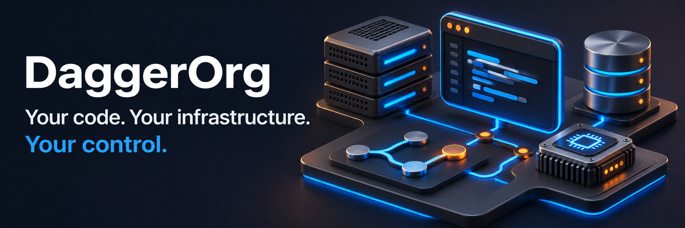
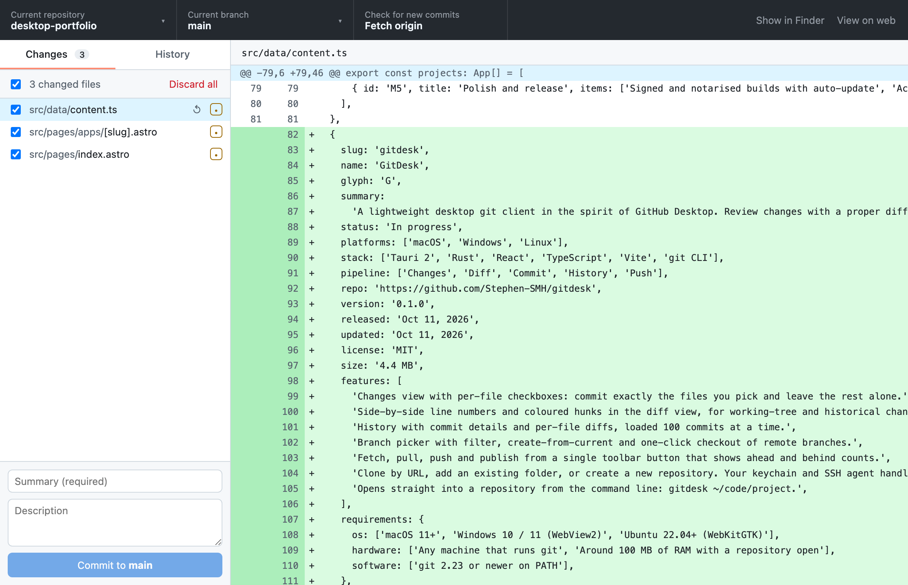
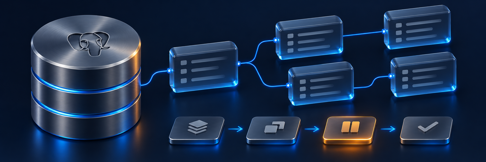
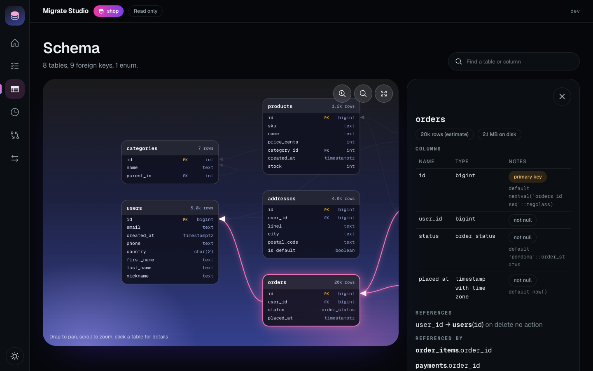
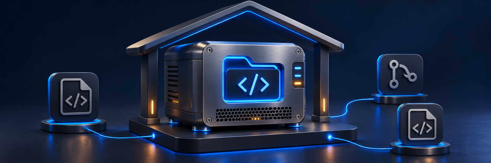
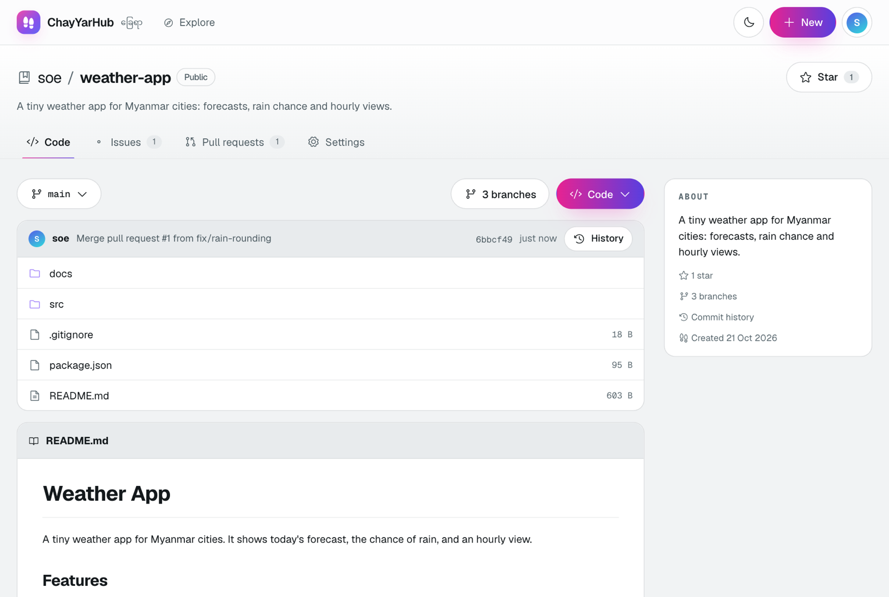
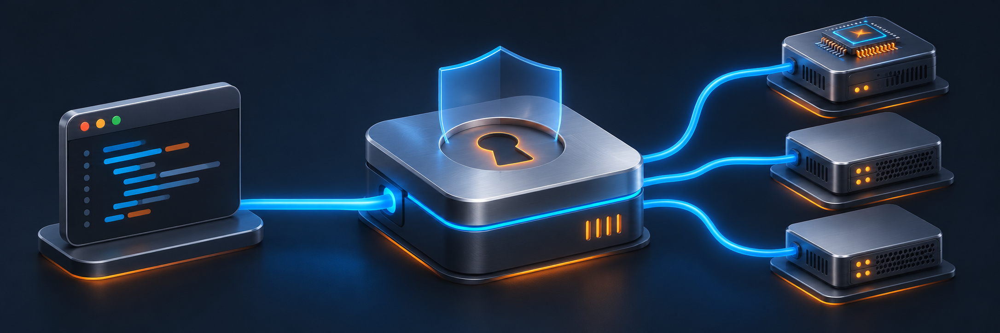

### Developer tools and self-hosted platforms. Built around your environment.

Review code. Understand database changes. Host your repositories. Run local AI.

**Four tools. One goal: more control over how you build.**

[Explore Projects](https://github.com/orgs/DaggerOrg/repositories) &nbsp; · &nbsp; [GitDesk](https://github.com/DaggerOrg/gitdesk) &nbsp; · &nbsp; [SQLMal](https://github.com/DaggerOrg/sqlmal) &nbsp; · &nbsp; [LocalGate](https://github.com/DaggerOrg/local-llm-gateway)

 

---

## Built for the work behind the software.

DaggerOrg builds practical tools for managing code, evolving databases, and running AI services in your own environment. Focused interfaces help you understand changes and keep everyday engineering work moving.

| [ **GitDesk**](https://github.com/DaggerOrg/gitdesk) | [ **SQLMal**](https://github.com/DaggerOrg/sqlmal) | [ **ChayYarHub**](https://github.com/DaggerOrg/chayyarhub) | [ **LocalGate**](https://github.com/DaggerOrg/local-llm-gateway) |
| :---: | :---: | :---: | :---: |
| Visual Git workflows | Database migrations | Self-hosted collaboration | Local AI infrastructure |

 

<h2> GitDesk</h2>
### Keep your next commit in focus.

A lightweight Git client for desktop and browser. Review diffs, select changes, manage branches, and synchronize repositories through one interface.

**Review changes &nbsp; · &nbsp; Browse history &nbsp; · &nbsp; Manage branches &nbsp; · &nbsp; Sync repositories**

<strong>See GitDesk in action — open screenshot</strong>

[**Explore GitDesk →**](https://github.com/DaggerOrg/gitdesk)

 

<h2> SQLMal</h2>
### See what your database changes.

Manage PostgreSQL migrations with schema visualization, a replayable migration timeline, reversibility checks, and drift detection.

**One Go binary. Built-in web interface. No account required.**

<strong>See SQLMal in action — open screenshot</strong>

[**Explore SQLMal →**](https://github.com/DaggerOrg/sqlmal)

 

<h2> ChayYarHub</h2>
### Give your code a home you operate.

A self-hosted platform for Git repositories, code browsing, issue tracking, and pull requests.

**Host repositories &nbsp; · &nbsp; Browse code &nbsp; · &nbsp; Track issues &nbsp; · &nbsp; Review pull requests**

<strong>See ChayYarHub in action — open screenshot</strong>

[**Explore ChayYarHub →**](https://github.com/DaggerOrg/chayyarhub)

 

<h2> LocalGate</h2>
### Local models. One consistent API.

Connect applications to local inference through an OpenAI-compatible gateway, with model routing, access controls, and failure handling.

| 🔀 Model routing | 🔑 Access control |
| :--- | :--- |
| Map application-facing model names to inference backends. | Manage API keys and role-based permissions. |
| **🛡️ Resilience** | **⚖️ Shared capacity** |
| Handle backend failures with retries, circuit breakers, and fallback models. | Apply Redis-backed rate limits to shared inference capacity. |

[**Explore LocalGate →**](https://github.com/DaggerOrg/local-llm-gateway)

---

## Your environment. Your workflow.

| 🏗️ Deployment control | 🔎 Clear workflows | 🔌 Familiar interfaces |
| :--- | :--- | :--- |
| Run local tools and self-hosted services on infrastructure you operate. | Review code changes, inspect database evolution, and manage model access. | Work with Git, PostgreSQL, and OpenAI-compatible APIs. |

 

### Find your next tool.

Explore the projects, review their capabilities, and get started.

 

Project status, setup instructions, licensing, and contribution guidance are available in each repository.

