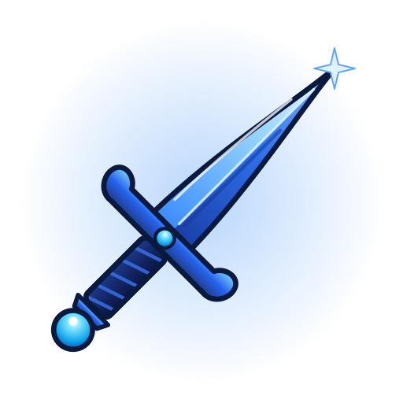

  

<h1 align="center">Dagger</h1>

  Developer tools, local-first AI and backend systems. 
  Most of them run entirely on your own machine or server.

---

## Developer tools

| Project | What it does | Built with |
| --- | --- | --- |
| [**ChayYarHub**](https://github.com/DaggerOrg/chayyarhub) | A self-hosted git hub. Push to a server you run, then browse code and history, track issues, and review and merge pull requests in the browser. | Angular · NestJS · SQLite |
| [**GitDesk**](https://github.com/DaggerOrg/gitdesk) | A lightweight desktop git client (about 4.4 MB) for changes, commits, history, branches and sync. The same UI also runs in a browser tab. | Tauri 2 · Rust · React |
| [**SQLMal**](https://github.com/DaggerOrg/sqlmal) | Runs PostgreSQL migrations and shows what they do: a live schema diagram, a timeline you can replay, lint rules for risky SQL, and drift detection. One binary with the UI built in. [Live demo →](https://daggerorg.github.io/sqlmal/) | Go · React · PostgreSQL |

ChayYarHub and GitDesk are the first two members of the **ChayYar** family, a set of tools that relate to each other the way GitHub and GitHub Desktop do. *ChayYar* (ခြေရာ) is Burmese for "footprints": every commit leaves one.

## AI

| Project | What it does | Built with |
| --- | --- | --- |
| [**LocalGate**](https://github.com/DaggerOrg/local-llm-gateway) | A self-hosted, OpenAI-compatible gateway for local LLMs. Apps call one stable API, and the gateway handles model routing, retries, circuit breakers, API keys with roles, and rate limits. | Python · Ollama · PostgreSQL · Redis |
| [**Educa**](https://github.com/DaggerOrg/Educa) | A prototype curriculum builder. Describe a course in one prompt, watch the syllabus build live, refine it, draft lessons, then publish behind a review gate. | React · TypeScript · FastAPI · CopilotKit · Agno |

## Backend

| Project | What it does | Built with |
| --- | --- | --- |
| [**Hospital**](https://github.com/DaggerOrg/hospital) | Middleware APIs for staff sign-in and patient search, with each hospital's data kept separate from the others. | Go · Gin · PostgreSQL · Docker · Nginx |

---

  More projects are in progress and will be opened up when they're ready. 
  Games live next door at <a href="https://github.com/GazarGames">Gazar Games</a>. 
  Maintained by <a href="https://github.com/Stephen-SMH">Soe Moe Htet</a>.

